# 🪶 Inkloom AI: Pre-publication Brand Governance

**The evidence and approval layer that stops off-brand, inaccurate and inaccessible content before it goes live. Every finding cites your own approved source. A named human approves. The AI never publishes.**

*CODENEXUS Hackathon · Round 2 · Team MASTERCODERS*

**Live demo:** `<add your Vercel link here>` · No sign-up: pick a role and explore.

| 🔎 Check types | 👥 Roles | 📎 Findings with a citation | 🧪 Automated tests | 🚫 Auto-publishes |
|:-:|:-:|:-:|:-:|:-:|
| **7** | **3** | **24 of 24** | **12 passed** | **0** |
| claims · facts · terms · tone · contrast · alt text · restricted phrases | creator · brand · compliance | in the seeded demo workspace | engine, seed data, full approval workflow | a human always decides |

All figures come from a **seeded, synthetic workspace** (the fictional company *Northwind Analytics*). See [Evidence](#evidence) and [Known limits](#known-limits).

**Jump to:** [Problem](#the-problem) · [What it does](#what-it-does) · [Why it is different](#what-makes-inkloom-different) · [Architecture](#architecture) · [Workflows](#workflows) · [Data model](#data-model) · [Checklist](#feature-checklist) · [Evidence](#evidence) · [Status](#status) · [Limits](#known-limits) · [Responsible AI](#responsible-ai-privacy-and-security) · [Run it](#run-it) · [Demo script](#demo-script) · [Team](#team)

---

## 🎯 The problem

Organisations now publish through employees, regional teams, agencies and generative AI tools. Brand rules, approved product facts and legal claim limits live in **separate documents** that creators rarely open and reviewers cannot check at scale. So off-brand wording, outdated numbers, unsupported promotional claims and inaccessible images reach the public.

The rules exist. What is missing is something that **checks each piece of content against them before it goes live, explains every finding, and keeps a human in control of the final decision.**

| Fact | Source |
|---|---|
| **70%** of organisations report hallucinations or misinformation in AI-generated content, and only **3%** of marketing leaders can identify appropriate controls for key AI risks. | EY |
| Over **70%** of marketers have already encountered an AI-related incident: hallucinations, bias or off-brand content. | IAB |
| **68%** of professionals say brand consistency contributed to revenue growth. | Marq (formerly Lucidpress) |
| **74%** of U.S. consumers believe brands should disclose their use of AI in advertising. | Cint |

*Figures are quoted as cited in our Round 1 submission. Check the original reports before reusing them.*

### Why existing tools fall short

| Tool category | What it does well | What it misses | What Inkloom adds |
|---|---|---|---|
| Brand guideline PDFs | Define the rules | Passive: nobody checks content against them at the moment it matters | Turns rules into **checkable, numbered records** |
| Grammar and style checkers | Spelling, grammar, generic tone | Do not know your product facts, approved terms or legal claim limits | Checks against **your own** facts, glossary and claim evidence |
| Digital asset managers | Store and version approved assets | Do not check how an asset is used inside a post | Checks contrast and alt text **in context** |
| Generic AI writing assistants | Generate and rewrite fluently | Can invent facts, ignore brand rules, give no citation | AI may only **cite retrieved evidence**; every number is guarded |
| Approval tools | Route content to reviewers | Reviewers get no evidence, so they re-check everything or trust blindly | Reviewers see **findings with citations**, and claim items go to the right specialist |

---

## ✨ What it does

| # | Step | What happens | In this demo |
|---|---|---|---|
| 1 | **Learn your rules** | Brand Manager maintains rules and glossary; Compliance maintains claims and facts with owners and expiry dates; guideline PDF/DOCX/TXT files can be imported into rules | ✅ |
| 2 | **Check** | Seven checks run on every draft: unsupported claims, outdated facts, non-approved terms, restricted phrases, tone, low contrast, missing alt text | ✅ |
| 3 | **Explain** | Every finding shows severity, reason, the **exact source it relies on**, and the flagged text highlighted in place | ✅ |
| 4 | **Fix** | A minimal suggested edit is shown as a before/after change. The creator can **accept, edit or dispute** (a reason is required) | ✅ |
| 5 | **Route** | Submit goes to the Brand Manager. If a claim was involved, it automatically continues to the Compliance Reviewer | ✅ |
| 6 | **Approve** | A named human approves or sends back with a written reason. Nobody approves their own content | ✅ |
| 7 | **Publish and disclose** | Only the author publishes, only after approval. An AI-use record is attached | ✅ |
| 8 | **Audit** | Every version, comment and decision is logged. One click exports an audit report | ✅ |
| 9 | **Learn from it** | Role-specific dashboards show recurring issues, issues by author and expiring evidence | ✅ |

---

## 🧭 What makes Inkloom different

> Most tools put an AI in front of a style guide. **Inkloom treats brand governance as an evidence problem.**

1. **Evidence-gated findings.** A finding is only asserted if it carries a citation: a guideline rule, a fact record, a claim record, a glossary entry or a WCAG criterion. Anything the AI cannot back with evidence is labelled **"needs human review"** instead of being stated as fact.
2. **Facts and claims are first-class records with owners and expiry dates.** Expired evidence is flagged automatically, so a number that was true last quarter does not quietly stay in circulation.
3. **Rules decide exactness; AI judges language; humans decide publishing.** Contrast ratios, glossary matches, alt text and exclamation limits run as deterministic code and are never guessed. AI is used only where language understanding is needed.
4. **The AI is fenced in.** Quotes must exist verbatim in the content, replacement wording may only use numbers found in the cited evidence, and a second, narrower verification pass drops findings the evidence does not support.
5. **Separation of duties built into the product.** The Brand Manager owns rules and glossary; the Compliance Reviewer owns claims and facts. Each role sees only what their job needs, and reviewers cannot approve their own work.
6. **Governance is the product, not an afterthought.** Versions, reviewer comments, disputes, notifications, the AI-use record and an exportable audit report exist from the first click.
7. **Works with no AI vendor at all.** Without an API key, a rule-based engine runs the whole workflow and the interface says which engine ran. AI is an upgrade, not a dependency.

### Capability comparison

*Typical capabilities of each category, not a review of any specific product.*

| Capability | Style-guide PDF | Grammar checker | Generic AI assistant | Approval tool | **Inkloom** |
|---|:-:|:-:|:-:|:-:|:-:|
| Checks content against **your** approved facts | ❌ | ❌ | 🟡 only if you paste them in | ❌ | ✅ |
| Every finding cites a source | ❌ | ❌ | ❌ | ❌ | ✅ |
| Facts and claims carry an owner and expiry date | ❌ | ❌ | ❌ | 🟡 | ✅ |
| Exact checks are deterministic (contrast, glossary) | ❌ | 🟡 | ❌ | ❌ | ✅ |
| Suggests minimal fixes that keep the author's intent | ❌ | 🟡 | 🟡 may rewrite freely | ❌ | ✅ |
| Named human approval with a full audit trail | ❌ | ❌ | ❌ | ✅ | ✅ |
| Separate owners for rules and for evidence | ❌ | ❌ | ❌ | 🟡 | ✅ |
| Fully usable without an AI vendor | ✅ | 🟡 | ❌ | ✅ | ✅ |

---


## 👀 See it
Add these four screenshots to docs/screenshots/ (see docs/screenshots/README.md) and uncomment this block.

| Findings with citations | Role-based overview |
|---|---|
| 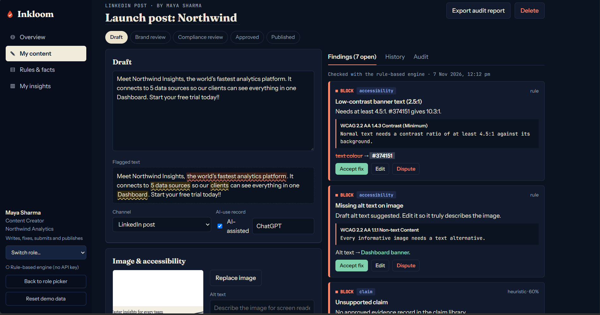 | 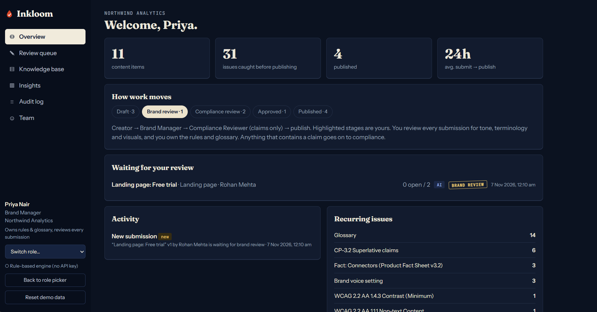 |

| Compliance sign-off | Insights and audit |
|---|---|
| 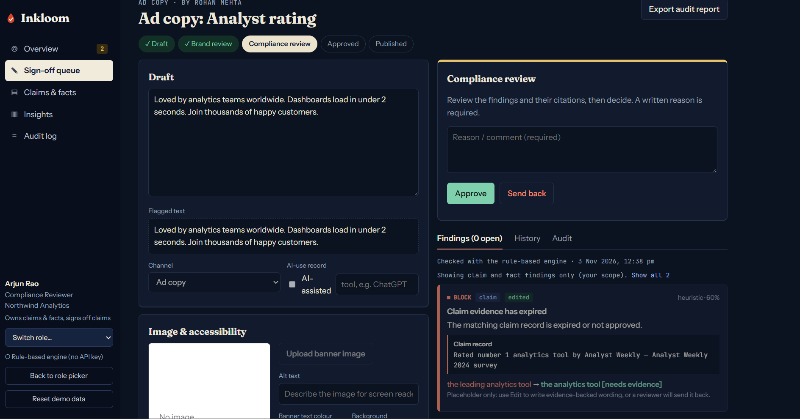 | 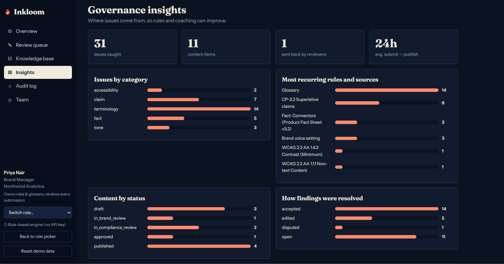 |


## 🏗️ Architecture

The demo is a **single-page React app with no server**. The whole product, including the checking engine and the approval workflow, runs in the browser and is deployed as static files on Vercel.

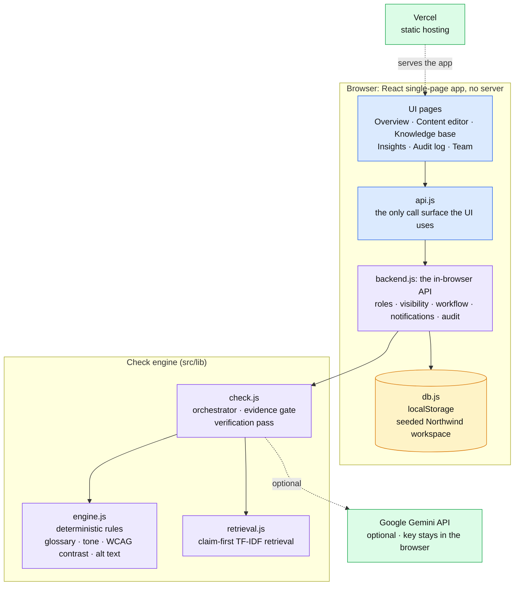

**Reading the diagram:**

- **Rules decide exactness; AI judges language; humans decide publishing.** The deterministic engine never guesses. The optional AI never publishes.
- **One call surface.** The UI talks only to `api.js`. Replacing `backend.js` with a real server changes nothing in the interface (this is exactly how the full-stack version works).
- **Roles are enforced in the backend layer, not just hidden in the UI.** Visibility, ownership and workflow rules are checked on every call.
- **The AI is optional.** No key means the rule-based engine runs end to end. With a Gemini key stored in the browser, the evidence-bound judge, the verification pass, AI alt text and AI guideline extraction switch on.
- **Seeded and resettable.** `db.js` seeds the Northwind workspace into `localStorage`; "Reset demo data" restores it.

### From demo to production

A full-stack build of the same product already exists (React, Express, MongoDB, Gemini, JWT auth, file uploads). The path from this demo is a straight swap of the in-browser backend:

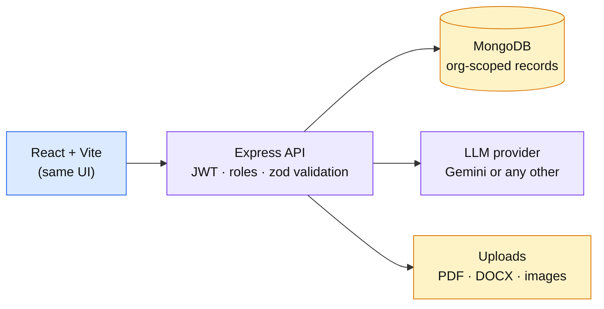

---

## 🔄 Workflows

### 1. The check pipeline

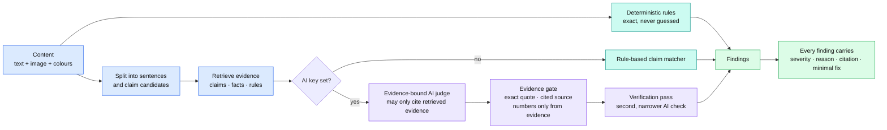

- **Deterministic rules** cover glossary and restricted phrases, the exclamation limit, WCAG contrast (computed, not estimated) and missing alt text.
- **Claim-first retrieval** splits content into sentences and pulls only the relevant claim, fact and rule records for each risky sentence (superlatives, comparatives, numbers).
- **Evidence gate** (AI mode): the quote must appear verbatim in the content, the cited source must be one that was retrieved, and any replacement may only use numbers that appear in that evidence. Otherwise the fix is withheld and the finding is marked for human review.
- **Verification pass** (AI mode): a second, narrower call checks that the cited passage really supports the finding, and drops it if not.
- **Rule-based mode:** the same workflow runs without AI, with pattern-based claim detection against the claim library and fact base.

### 2. The approval workflow

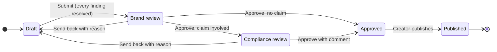

Rules enforced by the product:

- Submit is blocked until **every finding is resolved** (accepted, edited or disputed with a reason) and the check is current.
- A **written reason is required** for every approve or send-back decision.
- **Authors cannot approve their own content.**
- Content that still contains a **"[needs evidence]" placeholder** cannot be approved.
- A claim anywhere in the findings **routes the item to Compliance** after Brand approval.
- Only the **author** can publish, and only **approved** content.

### 3. One piece of content, start to finish

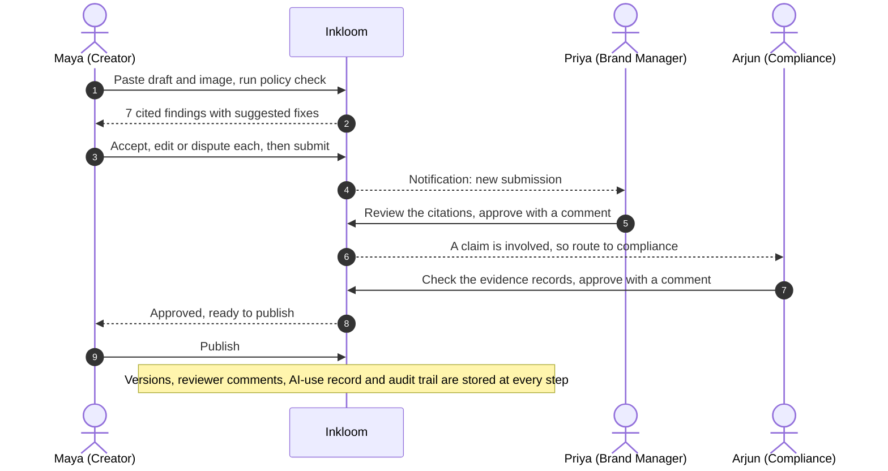

### 4. Who owns what

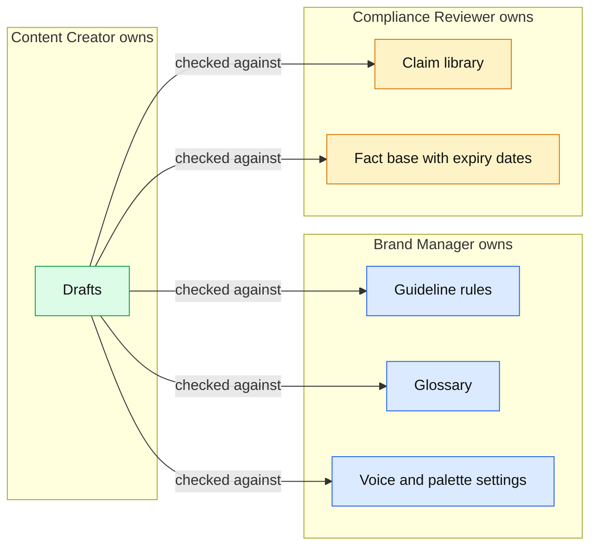

| | Content Creator | Brand Manager | Compliance Reviewer |
|---|---|---|---|
| **Owns** | their drafts | guideline rules, glossary, voice and palette settings | claim library, fact base (with expiry) |
| **Sees** | only their own content | every submitted item (drafts stay private) | only items that contain a claim, plus what they decided |
| **Does** | writes, checks, resolves findings, submits, publishes own approved items | reviews tone, terms and visuals; approves or sends back; routes claim items on | checks each citation against its evidence record; approves or sends back |
| **Dashboard** | own track record | recurring issues, issues by author | evidence watch: expired and expiring records |

---

## 🗂️ Data model

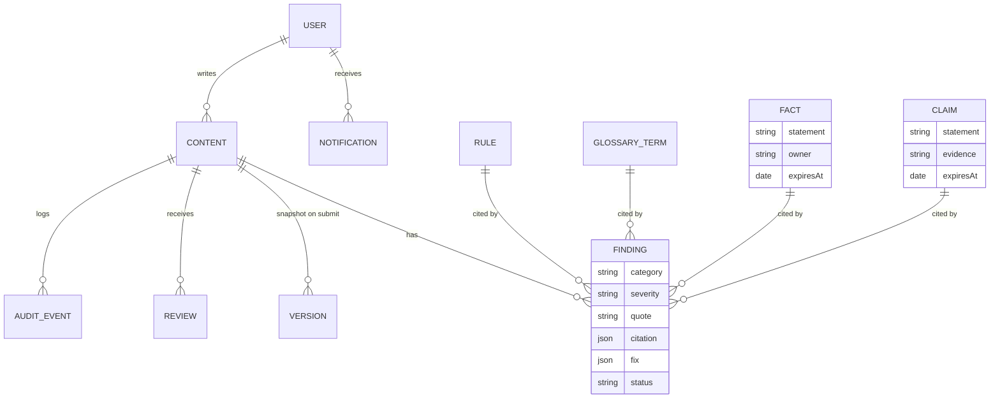

`FINDING.citation` always points at the record it relies on, so a reviewer can verify any finding at a glance.

---

## ✅ Feature checklist

| Area | Feature | Status |
|---|---|:-:|
| **Checks** | Unsupported superlative, comparative and numeric claims | ✅ |
| | Outdated or conflicting facts, expired evidence flagged | ✅ |
| | Glossary: non-approved terms and restricted phrases | ✅ |
| | Tone: exclamation limit from brand settings | ✅ |
| | WCAG 2.2 AA text contrast (computed) | ✅ |
| | Missing alt text, with a suggested draft | ✅ |
| **Explainability** | Citation on every finding, flagged text highlighted | ✅ |
| | Minimal before/after fixes, accept / edit / dispute | ✅ |
| | "Needs human review" for anything without evidence | ✅ |
| **Workflow** | Creator → Brand → Compliance (claims only) → Publish | ✅ |
| | Written reason for every decision, no self-approval | ✅ |
| | In-app notifications between roles | ✅ |
| **Governance** | Version history, AI-use record, audit log | ✅ |
| | Exportable audit report (JSON) | ✅ |
| | Role-specific dashboards and insights | ✅ |
| **Knowledge** | Rules, facts, claims, glossary with role ownership | ✅ |
| | Guideline import from PDF, DOCX, TXT | ✅ |
| **AI (optional)** | Evidence-bound judge, verification pass, AI alt text, AI rule extraction | 🟡 needs a user-supplied Gemini key |
| **Platform** | Real accounts, SSO, shared multi-user data | ⬜ full-stack version / roadmap |
| | Plugins: Figma, Canva, Slack, CMS | ⬜ roadmap |
| | OCR for text inside images | ⬜ roadmap |
| | Multi-language and multi-market rule sets | ⬜ roadmap |

---

## 🧪 Evidence

### Automated tests (`npm test`): 12 passed

| Suite | Tests | What it proves |
|---|:-:|---|
| `engine.test.js` | 4 | Contrast maths matches WCAG (black on white is 21:1); terms, tone, contrast and alt text are caught with citations; an outdated fact and an unsupported superlative are flagged; an already-supported claim is **not** flagged |
| `seed.test.js` | 5 | Every checked demo item yields cited findings; the live-demo draft triggers all seven check types; final texts are clean after fixes; an expired fact needs human review; claim items route to compliance and brand-only items do not |
| `flow.test.js` | 3 | Role visibility and ownership are enforced; the complete path check → resolve → submit → brand → compliance → publish works, including notifications and the audit export; send-back, disputes and insights behave |

### The seeded workspace by the numbers

| | |
|---|---|
| Content items | 11 across every stage (3 drafts including one sent back, 1 in brand review, 2 in compliance review, 1 approved, 4 published) |
| Findings | 24, and all 24 carry a citation |
| Knowledge base | 9 rules, 4 facts (1 expired), 3 claims (1 expired, 1 expiring soon), 4 glossary entries |
| Versions · reviews · audit events · notifications | 9 · 11 · 65 · 11 |
| People | Maya and Rohan (creators), Priya (brand), Arjun (compliance) |

### The live-demo draft: "Launch post"

Run the check on this draft and Inkloom returns **seven cited findings**:

| # | Finding | Severity | Cited source |
|---|---|---|---|
| 1 | Low-contrast banner text (2.5:1) | block | WCAG 2.2 AA 1.4.3, suggested approved colour `#374151` |
| 2 | Missing alt text on the banner image | block | WCAG 2.2 AA 1.1.1, draft alt text offered |
| 3 | "the world's fastest analytics platform" is an unsupported claim | block | Rule CP-3.2, Superlative claims |
| 4 | "clients" is a non-approved term | fix | Glossary: use "customers" |
| 5 | "Dashboard" is a non-approved term | fix | Glossary: product name is "Insights Hub" |
| 6 | "5 data sources" conflicts with the approved figure | fix | Fact: Connectors, Product Fact Sheet v3.2 (12) |
| 7 | Too many exclamation marks | advise | Brand voice setting (max 1) |

---

## 📍 Status

| Live in this demo | Built, in the full-stack version | Roadmap |
|---|---|---|
| Whole workflow, three roles, seven checks, citations, notifications, audit, insights, guideline import, optional Gemini | Express + MongoDB backend, JWT accounts, organisation invite codes, server-side file uploads | SSO, Slack and CMS plugins, OCR, multi-language, learned thresholds from reviewer feedback, vector search at scale |

## ⚠️ Known limits

We would rather you hear these from us.

- **Browser-only data.** In this demo each visitor has their own copy of the data in their browser. Nothing is shared between devices, and clearing site data resets it.
- **Rule-based claim detection is pattern-based.** It catches superlatives, comparatives and numeric claims from a list of patterns, so subtle or novel phrasing can slip past it. The optional AI judge exists to cover that gap, but it has not been evaluated at scale.
- **Retrieval is simple.** It uses TF-IDF word overlap, which suits a small knowledge base. Large knowledge bases would need vector search.
- **Tuned on demo data.** The rule-based heuristics were developed against the seeded workspace. We have **not** measured accuracy on a real-world corpus, and we make no accuracy claim.
- **Contrast uses chosen colours.** The banner text and background colours are set by the creator. We do not yet read text out of image pixels (no OCR).
- **English only,** and a single organisation per demo.
- **Image uploads are capped at 1.5 MB** in the browser build. Guideline import without an AI key falls back to line-by-line extraction.
- **No real authentication in the demo.** The role picker is for exploration, not security.
- **Third-party statistics** in [The problem](#the-problem) come from the reports named there, as cited in our Round 1 submission.

## 🔐 Responsible AI, privacy and security

- **Human in the loop by design.** The AI never publishes. A named human approves or rejects every item, with a written reason.
- **Explainable.** Every finding states the rule or record it relies on and why the content conflicts with it.
- **Disputes are first-class.** A creator can dispute a finding with a reason; the decision is logged.
- **Transparent AI use.** Each item records whether AI helped create it and which tool, and the record travels with the audit export.
- **Data minimisation.** If AI mode is switched on, only the content under review and the retrieved evidence passages are sent to the model, never the whole knowledge base.
- **Your key stays yours.** A Gemini key entered in the demo is stored only in that browser's `localStorage`. Never hard-code a key into a public deployment.
- **Fictional data only.** The demo contains no real people, customers or confidential material.

## 🧰 Tech stack

| Layer | Choice |
|---|---|
| UI | React 18, React Router, Vite |
| Check engine | Plain JavaScript modules: deterministic rules, TF-IDF retrieval, evidence-gated orchestrator |
| Storage (demo) | Browser `localStorage`, seeded on first load |
| Optional AI | Google Gemini REST API, called from the browser with a user-supplied key |
| Guideline import | `pdfjs-dist` (PDF), `mammoth` (DOCX), plain text |
| Hosting | Vercel, static build with a single-page-app rewrite |
| Tests | Node's built-in test runner |

---

## ▶️ Run it

```bash
npm install
npm run dev        # http://localhost:5173
npm test           # 12 tests: engine, seed data, full approval workflow
npm run build      # production build into dist/
```

### Deploy to Vercel

1. Push this folder to a GitHub repository.
2. On vercel.com choose **Add New → Project**, import the repository and click **Deploy**. Vite is detected automatically and no environment variables are needed.
3. Share the `https://<name>.vercel.app` link. (`vercel.json` already contains the single-page-app rewrite.)

Or from a terminal: `npm i -g vercel && vercel --prod`.

### Optional: switch on the AI judge

Open **Knowledge base → Settings**, paste a free Gemini key from [Google AI Studio](https://aistudio.google.com/apikey), and run a check. The sidebar changes from "Rule-based engine" to "AI active". If Google rejects the default model name, set a model override in the same panel.

---

## 🎬 Demo script

| Min | Who | Show | Say |
|:-:|---|---|---|
| 0:00 | Landing page | Pick **Maya** | "Three roles, no sign-up. Each sees a different product." |
| 0:30 | Maya | Open *Launch post* → **Run policy check** | "Seven findings, and every one cites its source." |
| 1:15 | Maya | Point at the citation under each finding; accept fixes; **Edit** the claim with real wording; add alt text; dispute one finding | "Fixes keep her intent. Disputes need a reason and are logged." |
| 2:00 | Maya | **Submit for review** | "She can't submit until every finding is resolved." |
| 2:15 | Switch to **Priya** | Overview queue → open the item → approve with a comment | "Brand reviews tone and terms. A claim was involved, so it routes on." |
| 3:00 | Switch to **Arjun** | Claim and fact findings only; Evidence watch | "Compliance sees only what needs his sign-off, plus expiring evidence." |
| 3:30 | Switch to **Maya** | Notification → **Publish** | "Only the author publishes, only after approval." |
| 3:45 | Any | Insights, Audit log, **Export audit report** | "Every decision is explainable to an auditor." |

*"Reset demo data" in the sidebar restores everything for the next run.*

---

## 📁 Project structure

```
inkloom-demo/
├── src/
│   ├── App.jsx, main.jsx, styles.css
│   ├── api.js                 # the only call surface the UI uses
│   ├── lib/
│   │   ├── backend.js         # in-browser API: roles, visibility, workflow, audit
│   │   ├── engine.js          # deterministic rules + rule-based claim matcher
│   │   ├── retrieval.js       # claim-first TF-IDF retrieval
│   │   ├── check.js           # orchestrator, evidence gate, verification pass
│   │   ├── llm.js             # optional Gemini calls
│   │   ├── db.js              # localStorage store and seeding
│   │   └── seedData.js        # the Northwind demo workspace
│   └── pages/                 # Landing, Overview, Editor, Knowledge, Insights
├── tests/                     # engine, seed data and workflow tests
├── docs/diagrams/             # Mermaid sources for every diagram in this README
├── vercel.json
└── package.json
```

## 🛣️ Roadmap

1. Move from the browser store to the full-stack backend (accounts, shared workspaces).
2. OCR so contrast and claims inside images are checked too.
3. Plugins: Figma, Canva, Google Docs, Slack, CMS.
4. Multi-language and multi-market rule sets; regulated-industry claim packs.
5. Learn thresholds from reviewer feedback and disputes.
6. Automatic freshness alerts and owner reminders for expiring evidence.
7. Channel-specific AI disclosure labels.

## 👥 Team

**MASTERCODERS** · Vardhaman College of Engineering

| Member | Role |
|---|---|
| Busa Sanjay (team lead) | Product and research |
| Sowmya Ranjan Samanta | UI/UX design |
| Kuchipatla Sujith Rohan Reddy | Backend and AI engineering |
| Banoth Likhil Naik | Frontend and engineering |

*All names, companies and facts inside the demo workspace are fictional.*